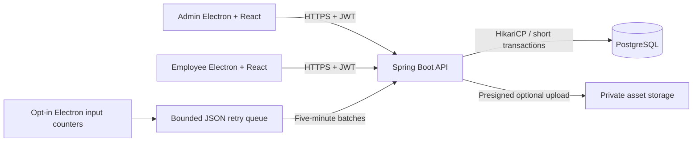
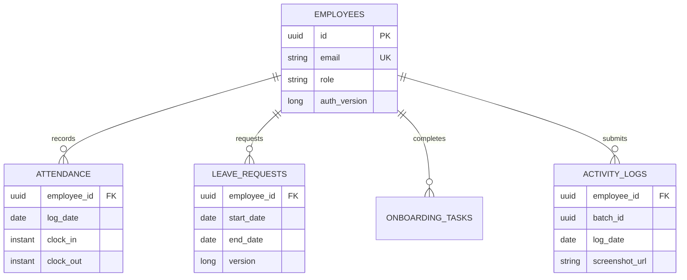

# Architecture

Frontend caches separate live authentication from persisted demo data. Access tokens never enter localStorage. API filter chains enforce URL roles; task controllers enforce record ownership. Logout increments an account token version. Stateless HTTP does not imply that JWT revocation has no persistent metadata.

The database uses Flyway migrations and Hibernate validation. Attendance serializes only operations for the same employee, with a database unique partial index as a second safeguard. Leave reviews use optimistic versioning. Telemetry transactions use per-user locks plus a unique batch key for safe retry. Onboarding task loading is batched for each candidate page to avoid a per-candidate query pattern. Application image blobs are absent from every table.

The desktop UI and main process have distinct privilege boundaries. Main-process hooks retain counters only; the preload exposes explicit commands, not raw filesystem, shell, or arbitrary IPC access. Production URL navigation and popups are blocked. Operating-system permissions and explicit user consent remain prerequisites for activity sharing.
